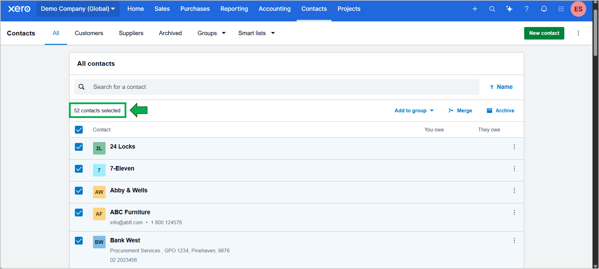
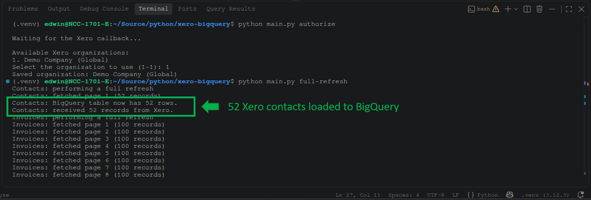
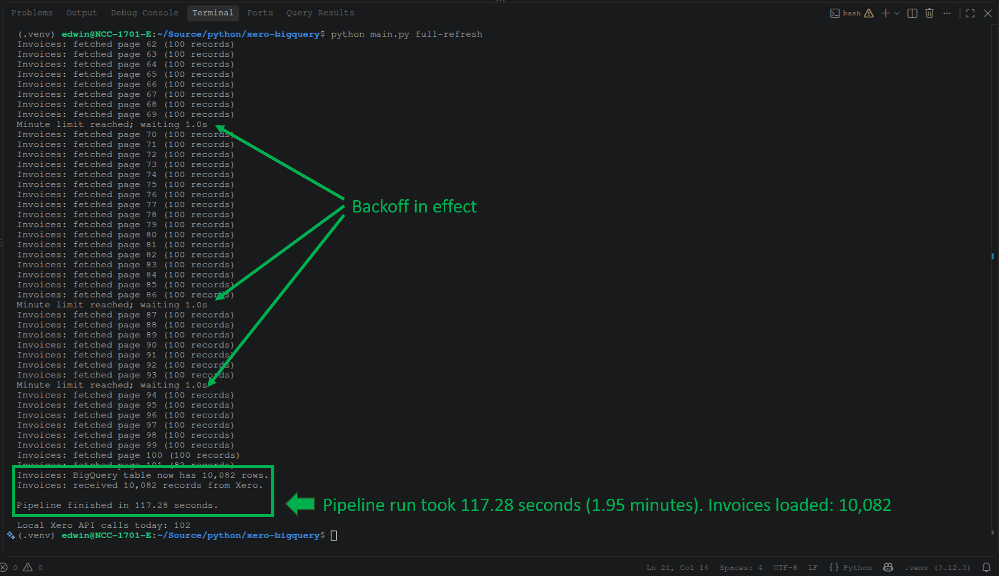
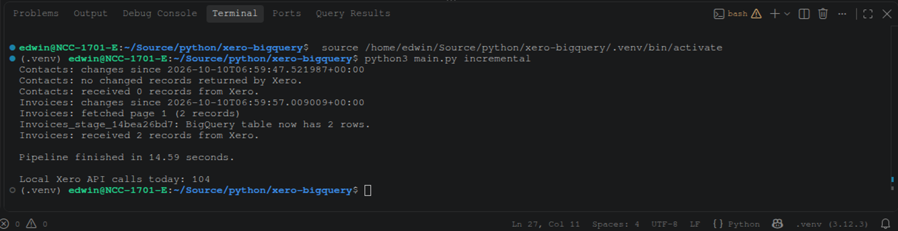

# Xero to BigQuery: Custom Python Pipeline

A small Python pipeline that extracts contacts and invoices from Xero and loads them into Google BigQuery. It is intended as a practical example of building a custom integration with OAuth 2.0, pagination, incremental synchronization, and BigQuery loading.

## Features

- Connects to Xero using OAuth 2.0.
- Stores authentication state locally and persists refreshed tokens.
- Retrieves paginated Xero data while accounting for API rate limits.
- Supports a full refresh and an incremental sync.
- Loads contacts and invoices into BigQuery.
- Keeps a local `.state/` directory for OAuth and synchronization state.

## Project structure

The project is organized around these files:

```text
custom_xero_pipeline/
├── config.py
├── xero_connection.py
├── bigquery_connection.py
├── pipeline.py
├── main.py
├── requirements.txt
├── .env                 # local secrets; do not commit
├── .gitignore
└── .state/              # local OAuth and sync state; do not commit
```

## Requirements

- Python 3.12 or another Python version supported by the installed dependencies.
- A Xero app configured for OAuth 2.0.
- Access to the Xero organization you want to synchronize.
- A Google Cloud project with BigQuery enabled and permission to create/load tables and run BigQuery jobs.
- Google Cloud CLI (`gcloud`) if you use Application Default Credentials for BigQuery authentication.

## Setup

### 1. Clone the repository

```bash
git clone https://github.com/YOUR-GITHUB-USERNAME/custom_xero_pipeline.git
cd custom_xero_pipeline
```

Replace `YOUR-GITHUB-USERNAME` with your GitHub username and adjust the repository name if needed.

### 2. Create and activate a virtual environment

On Linux or macOS:

```bash
python3 -m venv .venv
source .venv/bin/activate
```

On Windows PowerShell:

```powershell
py -m venv .venv
.venv\Scripts\Activate.ps1
```

### 3. Install dependencies

```bash
python -m pip install --upgrade pip
pip install -r requirements.txt
```

### 4. Configure environment variables

Create a local `.env` file in the project root and add the configuration values required by `config.py`. There's a .env.example file you can follow. These typically include your Xero app's client ID and client secret, OAuth redirect URI, Xero tenant ID, and BigQuery project/dataset settings.

Use the exact variable names expected by your version of `config.py`. Do not put real credentials in this README or commit `.env` to GitHub.

### 5. Authenticate with Google Cloud

If the project uses Google Application Default Credentials, run:

```bash
gcloud auth application-default login
```

Sign in with a Google account that has the required permissions in the target Google Cloud project.

## Usage

Run commands from the project root with the virtual environment activated.

### Authorize the Xero connection

```bash
python main.py authorize
```

Follow the authorization flow and grant the requested access. The app stores local authentication state for subsequent runs. Keep the `.state/` directory private; it may contain tokens or other sensitive state.

### Run a full refresh

```bash
python main.py full-refresh
```

This performs a full extraction and reload of the configured Xero contacts and invoices into BigQuery. In the benchmark setup, the destination dataset was `custom_xero`, with tables named `Contacts` and `Invoices`. Confirm the target project and dataset in your local configuration before running it.

### Run an incremental sync

```bash
python main.py incremental
```

The incremental workflow uses the pipeline's saved state and Xero change-detection logic to retrieve updates. Run the authorization step first, and preserve `.state/` between runs so token refresh and incremental progress can continue.

## API limits and operational notes

Xero applies API rate limits. This pipeline includes rate-limit handling, but large backfills can still take time and may need to be spread across multiple runs to stay within the limits applicable to your Xero app and organization. Review Xero's current API documentation before running large production workloads.

- Keep `.env` and `.state/` private.
- Do not delete `.state/` between incremental runs unless you intentionally want to reset local authentication/sync state and understand the consequences.
- Test with a small dataset before running a full refresh against important tables.
- Verify row counts and sample records in BigQuery after each run.
- A full refresh may replace existing destination table contents, depending on the write disposition configured in the code.
- This is an example integration, not a managed service. Monitor syncs and validate the resulting data before using it for financial reporting.

## Sample Data
I used Xero's Demo Company (Global) for my test case. Below is a preview of the 52 Xero Contacts:



And below is a preview of the 10,004 draft invoices:


Including pre-defined test data in the Demo Company, total invoices are 10,082.

## Sample Output

It starts with authorizing to get a refresh token, then followed by the initial sync:



It will continue with invoice rows at 100 rows/page until all rows are replicated to BigQuery:



Below is the incremental sync output during my test:




## Security

Never commit client secrets, access tokens, refresh tokens, service-account keys, or real customer data. Review `.gitignore` before your first commit and inspect `git status` to ensure secret files are not staged.

## License

This project is licensed under the MIT License. See [LICENSE](LICENSE).
# xero-to-bigquery-custom-python
